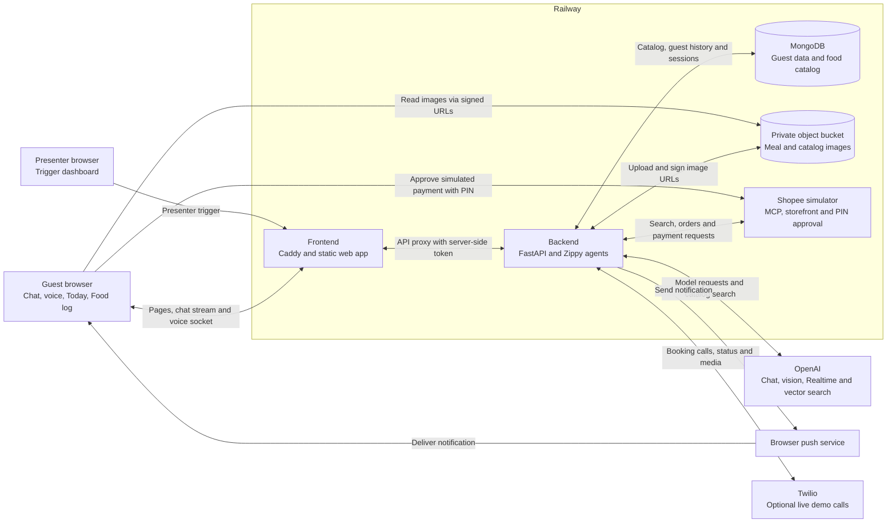

# Zippy architecture

Caddy serves the guest app and `/presenter.html`. It strips `/api` from proxied requests and adds the shared backend API token. The browser's guest cookie identifies its conversations and history. Presenter triggers also require a presenter key and can reach multiple guests with the same case-insensitive display name.

## How data moves

| Flow | Where it runs |
| --- | --- |
| **Chat and voice** | FastAPI returns streamed events for typed chat. The realtime voice WebSocket carries audio, transcripts, and cards. Completed turns are stored with the guest's session in MongoDB. |
| **Food lookup** | MongoDB is the source of catalog nutrition. With a managed OpenAI vector store configured, chat can retrieve up to 20 catalog matches, then resolve those IDs against MongoDB before using nutrition values. The index contains searchable menu fields. A direct MongoDB lookup is available when semantic search is unavailable. |
| **Meal photo** | The backend sends a resized image to a single OpenAI vision model, then stores the meal estimate in MongoDB. With bucket storage configured, it stores the photo there and signs a fresh URL for display. Catalog images also use signed URLs. |
| **Proactive recommendations** | A presenter trigger reads the selected guest's profile, health and meal history from MongoDB. Food suggestions use the catalog first and search nearby Shopee Food listings after the guest asks. Item suggestions use sleep or activity signals to search Shopee Mall. The backend posts results to chat and sends web push when configured. |
| **Exercise review** | The presenter sends a draft workout with the venue and estimated calories. For 71 Sports Club, the chat card shows a public map pin. The backend writes the workout to the guest's history when they choose **Log this**. |
| **Shopping and booking** | The backend calls the Shopee MCP endpoint to search, place orders, and request payment. The user enters their PIN on the simulator to approve payment. Booking calls are simulated by default. Live demo calls use Twilio with verified test numbers. |

## Deployment and API references

- [Backend and Railway setup](BE/README.md) covers MongoDB collections, private bucket configuration, OpenAI indexing, web push, and presenter configuration.
- [Frontend API guide](FE/CHAT_API.md) covers the guest cookie, chat stream, recommendations and health-history routes, and presenter requests.
- [Shopee simulator setup](MCP/README.md) covers its MCP tools, checkout handoff, and Railway deployment.
- [Cron setup](CRON/README.md) covers the standalone timestamp job. Presenter triggers run through the backend.
